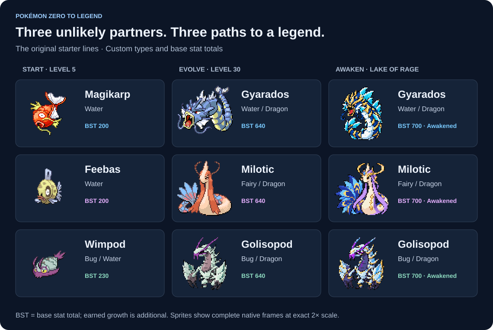
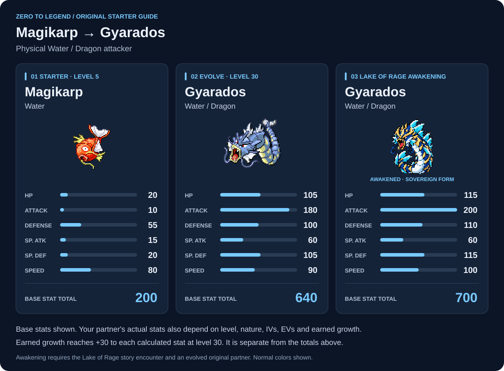
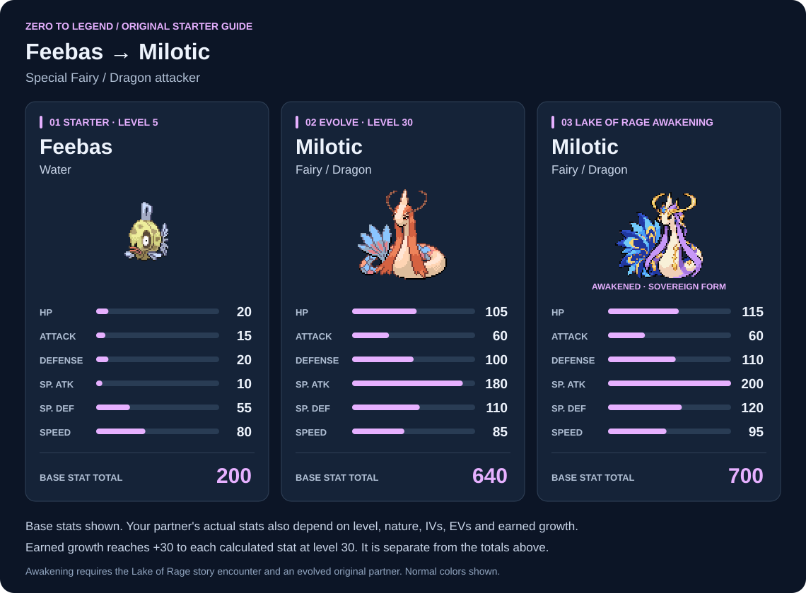
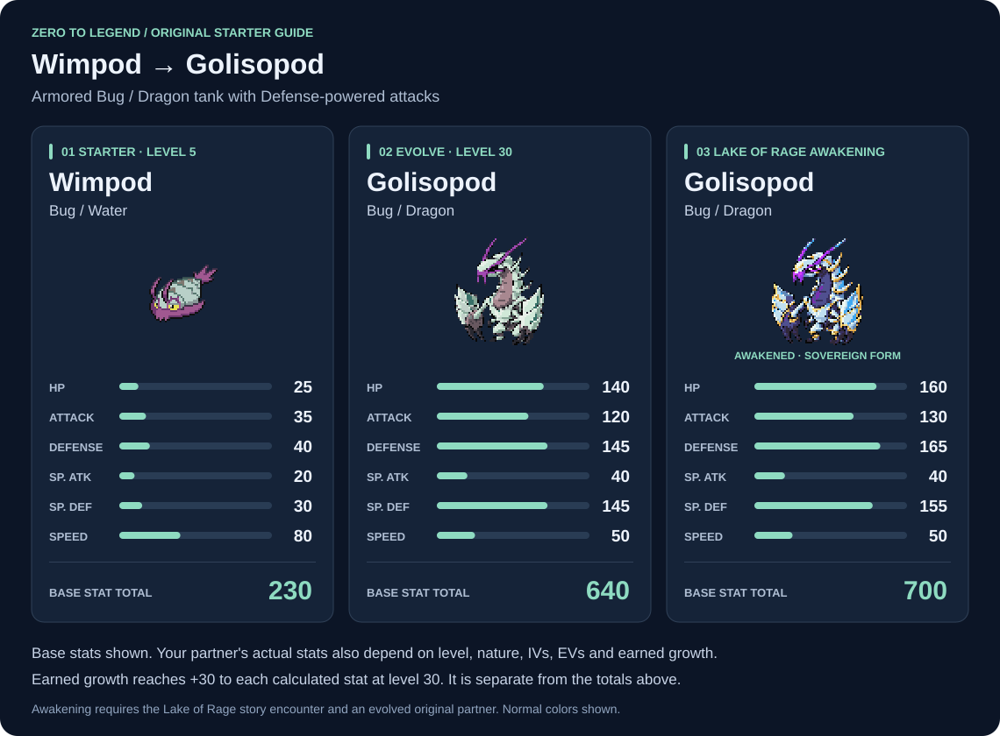

# Forms, stats and ordinary moves

[Home](README.md) · [Player guide](PLAYER-GUIDE.md) · [Training](TRAINING.md)

These custom paths belong to the original Magikarp, Feebas or Wimpod from Elm. All evolve at level 30; Feebas needs no Beauty or evolution item. The ordinary form data and learnsets below apply to v1.0. Level 100 surprises remain in-game.

## Reading the cards

The pictures use the game's Pokémon sprites in their regular colors. Awakened Gyarados is an armored sea tyrant and awakened Milotic a celestial serpent. **Golisopod becomes a plated, long-necked dragon as soon as Wimpod evolves**; awakening strengthens that same design with luminous armor. All have front/back battle views, party icons, and overworld followers. Your regular or shiny choice carries through evolution and awakening, using the appropriate palette for each species; party icons use shared menu colors. You can change shininess through [Starter Setup](PLAYER-GUIDE.md#starter-setup).

The numbers below are **species base stats**, with a total for comparison. Your partner's actual Skills-page numbers also depend on level, IVs, EVs, nature, and earned growth. The original earns +1 to each calculated stat per level after level 5, plus another +1 at levels 10, 15, 20, 25, and 30. That bonus caps at **+30 to every calculated stat at level 30** and remains after evolution and awakening. It is separate from the base stats and their totals.

Every stage retains **Legend's Resolve**. Evolution adds a species power. Awakening adds the Sovereign power for Gyarados and Milotic; Golisopod's Leviathan's Aegis replaces its evolved Bulwark. See the [powers guide](PLAYER-GUIDE.md#powers) and the [in-game Powers page](PLAYER-GUIDE.md#powers).

## Reading the move lists

Your Pokémon has **four equipped move slots**. These tables show its wider learnset, so an evolved or awakened partner does not have one mandatory four-move set. The level-5 row lists the exact starting slots in order. Later moves are learned as you progress, and evolution offers the signature move for you to accept or decline.

The original partner's **free Summary reminder** lets you choose eligible moves again. It includes young-form moves unlocked by your level even after evolution, evolved moves up to your level once evolved, the evolution signature, compatible moves you have actually been taught, and awakening moves once awakened. If you pass an evolved move's listed level before evolving, recover it through the reminder afterward. Compatibility alone does not unlock a TM or tutor move, and awakening does not automatically replace your equipped moves.

**Special moves can have permanent choices.** Read in-game warnings before replacing or deleting one.

To use the reminder: open your partner's **party Summary → battle Moves page → A → A → Relearn Move**. See [move management](PLAYER-GUIDE.md#move-management) for deletion and reordering.

## Magikarp → Gyarados

**Water → Water/Dragon → Water/Dragon.** Gyarados develops into a physical attacker, with its highest base stat in Attack and a physical Water signature.

### Base stats

| Form | HP | Attack | Defense | Sp. Atk | Sp. Def | Speed | Total |
| --- | ---: | ---: | ---: | ---: | ---: | ---: | ---: |
| Magikarp | 20 | 10 | 55 | 15 | 20 | 80 | **200** |
| Gyarados | 105 | 180 | 100 | 60 | 105 | 90 | **640** |
| Awakened Gyarados | 115 | 200 | 110 | 60 | 115 | 100 | **700** |

Evolution adds **Rising Tyrant**; awakening adds **Tidal Sovereign**. [Power details](PLAYER-GUIDE.md#powers).

### Natural move progression

| When | Form | Move unlocked |
| --- | --- | --- |
| Start · Lv. 5 | Magikarp | **Splash → Tackle → Aqua Jet → Flail** |
| Lv. 8 | Magikarp | Bite |
| Lv. 12 | Magikarp | Water Pulse |
| Lv. 16 | Magikarp | Twister |
| Lv. 20 | Magikarp | Crunch |
| Lv. 24 | Magikarp | Aqua Tail |
| Lv. 28 | Magikarp | Dragon Breath |
| On evolution · Lv. 30 or later | Gyarados | **Tyrant's Wake** |
| Lv. 34 | Gyarados / awakened | Dragon Claw |
| Lv. 38 | Gyarados / awakened | Liquidation |
| Lv. 42 | Gyarados / awakened | Ice Fang |
| Lv. 46 | Gyarados / awakened | Dragon Dance |
| Lv. 50 | Gyarados / awakened | Earthquake |
| Lv. 56 | Gyarados / awakened | Outrage |
| Lv. 62 | Gyarados / awakened | Wave Crash |
| Lv. 68 | Gyarados / awakened | Scale Shot |
| Lv. 75 | Gyarados / awakened | Dragon Rush |

**Tyrant's Wake** — Water / physical · **100 power · 100% accuracy · 5 PP**. Makes contact and has a 20% chance to lower the target's Defense by one stage.

**Awakening reminder unlocks:** Wave Crash, Outrage, Scale Shot, Earthquake. These become available through the reminder at awakening even if you have not reached their normal level-up milestones.

TM, HM, and tutor compatibility

These are compatible moves, not an automatic grant. You must first obtain the appropriate teaching opportunity; see [Blackthorn Special Training](PLAYER-GUIDE.md#blackthorn-special-training) for the late-game options.

| Form | Compatible moves |
| --- | --- |
| Magikarp | Protect, Rest, Substitute, Return |
| Gyarados / awakened | Waterfall, Surf, Dive, Dragon Claw, Dragon Tail, Earthquake, Rock Slide, Stone Edge, Ice Beam, Taunt, Rain Dance, Protect, Rest, Sleep Talk, Substitute, Aqua Tail, Ice Fang, Dragon Dance, Scale Shot, Outrage, Wave Crash, Crunch, Breaking Swipe, Return, Headbutt |

## Feebas → Milotic

**Water → Fairy/Dragon → Fairy/Dragon.** Milotic develops into a special attacker with recovery moves. Its custom evolution changes both types, so its Water attacks no longer match its own typing.

### Base stats

| Form | HP | Attack | Defense | Sp. Atk | Sp. Def | Speed | Total |
| --- | ---: | ---: | ---: | ---: | ---: | ---: | ---: |
| Feebas | 20 | 15 | 20 | 10 | 55 | 80 | **200** |
| Milotic | 105 | 60 | 100 | 180 | 110 | 85 | **640** |
| Awakened Milotic | 115 | 60 | 110 | 200 | 120 | 95 | **700** |

Evolution adds **Mystic Grace**; awakening adds **Celestial Sovereign**. [Power details](PLAYER-GUIDE.md#powers).

### Natural move progression

| When | Form | Move unlocked |
| --- | --- | --- |
| Start · Lv. 5 | Feebas | **Splash → Tackle → Water Gun → Disarming Voice** |
| Lv. 8 | Feebas | Mist |
| Lv. 12 | Feebas | Draining Kiss |
| Lv. 16 | Feebas | Water Pulse |
| Lv. 20 | Feebas | Dragon Breath |
| Lv. 24 | Feebas | Life Dew |
| Lv. 28 | Feebas | Dazzling Gleam |
| On evolution · Lv. 30 or later | Milotic | **Astral Cascade** |
| Lv. 34 | Milotic / awakened | Moonblast |
| Lv. 38 | Milotic / awakened | Dragon Pulse |
| Lv. 42 | Milotic / awakened | Surf |
| Lv. 46 | Milotic / awakened | Recover |
| Lv. 50 | Milotic / awakened | Calm Mind |
| Lv. 56 | Milotic / awakened | Hydro Pump |
| Lv. 62 | Milotic / awakened | Ice Beam |
| Lv. 68 | Milotic / awakened | Draco Meteor |
| Lv. 75 | Milotic / awakened | Stored Power |

**Astral Cascade** — Fairy / special · **95 power · 100% accuracy · 10 PP**. Its base recovery is 25% of the target's HP actually lost, subject to normal healing interactions.

**Awakening reminder unlocks:** Draco Meteor, Moonblast, Hydro Pump, Mystical Fire. The first three also appear in the level-up list; Mystical Fire is an additional awakening option.

TM, HM, and tutor compatibility

These are compatible moves, not an automatic grant. You must first obtain the appropriate teaching opportunity; see [Blackthorn Special Training](PLAYER-GUIDE.md#blackthorn-special-training) for the late-game options.

| Form | Compatible moves |
| --- | --- |
| Feebas | Protect, Rest, Substitute, Return |
| Milotic / awakened | Surf, Waterfall, Dive, Dragon Pulse, Dazzling Gleam, Ice Beam, Blizzard, Scald, Chilling Water, Calm Mind, Reflect, Light Screen, Rain Dance, Protect, Rest, Sleep Talk, Substitute, Moonblast, Recover, Draco Meteor, Life Dew, Heal Bell, Mystical Fire, Misty Terrain, Return |

## Wimpod → Golisopod

**Bug/Water → Bug/Dragon → Bug/Dragon.** Golisopod becomes an armored dragon with high HP and both defenses, reliable physical attacks, recovery and draining moves. Its custom evolution replaces Water with Dragon. The design is inspired by **[@jjonnydraws](https://www.youtube.com/@jjonnydraws)** and his Golisorus concept; it remains Golisopod in this game.

### Base stats

| Form | HP | Attack | Defense | Sp. Atk | Sp. Def | Speed | Total |
| --- | ---: | ---: | ---: | ---: | ---: | ---: | ---: |
| Wimpod | 25 | 35 | 40 | 20 | 30 | 80 | **230** |
| Golisopod | 140 | 120 | 145 | 40 | 145 | 50 | **640** |
| Awakened Golisopod | 160 | 130 | 165 | 40 | 155 | 50 | **700** |

Evolution adds **Abyssal Bulwark**: ordinary move damage is reduced by 25%, and opposing Defense/Sp. Def drops are blocked. Awakening replaces it with **Leviathan's Aegis**, giving 40% reduction and 1/16 max HP recovery per turn. They do not stack. [Power details](PLAYER-GUIDE.md#powers).

### Natural move progression

| When | Form | Move unlocked |
| --- | --- | --- |
| Start · Lv. 5 | Wimpod | **Tackle → Struggle Bug → Aqua Jet → Defense Curl** |
| Lv. 8 | Wimpod | Bug Bite |
| Lv. 12 | Wimpod | Slash |
| Lv. 16 | Wimpod | Razor Shell |
| Lv. 20 | Wimpod | Leech Life |
| Lv. 24 | Wimpod | Sucker Punch |
| Lv. 28 | Wimpod | Iron Defense |
| On evolution · Lv. 30 or later | Golisopod | **Abyssal Cross, Titan Carapace, First Impression** |
| Lv. 32 | Golisopod / awakened | Liquidation |
| Lv. 34 | Golisopod / awakened | Abyssal Renewal |
| Lv. 35 | Golisopod / awakened | Abyssal Leech |
| Lv. 38 | Golisopod / awakened | Dragon Claw |
| Lv. 42 | Golisopod / awakened | Sucker Punch |
| Lv. 46 | Golisopod / awakened | Iron Head |
| Lv. 50 | Golisopod / awakened | Swords Dance |
| Lv. 56 | Golisopod / awakened | Outrage |
| Lv. 62 | Golisopod / awakened | Close Combat |
| Lv. 68 | Golisopod / awakened | Megahorn |

**Abyssal Cross** — Dragon / physical · **80 power · 100% accuracy · 10 PP · +1 priority**. Uses the user's Defense instead of Attack and makes contact. Titan Carapace boosts both defenses by two stages, strengthening this attack. Abyssal Renewal restores half max HP and cures major status/confusion. Abyssal Leech is a 95-power physical Bug attack that drains half the HP actually lost, subject to ordinary drain interactions. Each of the three support moves has 10 PP.

**Awakening reminder unlocks:** Abyssal Cross, Abyssal Renewal, Titan Carapace, Abyssal Leech, Close Combat, Megahorn, Liquidation, Dragon Claw. These become available through the reminder at awakening even if you have not reached their normal evolved-form milestones. Wimpod's earlier Leech Life remains available too. Existing equipped moves are never replaced automatically.

TM, HM, and tutor compatibility

These are compatible moves, not an automatic grant. You must first obtain the appropriate teaching opportunity; see [Blackthorn Special Training](PLAYER-GUIDE.md#blackthorn-special-training) for the late-game options.

| Form | Compatible moves |
| --- | --- |
| Wimpod | Protect, Rest, Substitute, Return, Headbutt, Cut |
| Golisopod / awakened | Surf, Waterfall, Dive, X-Scissor, Leech Life, U-turn, Dragon Claw, Dragon Tail, Brick Break, Poison Jab, Iron Head, Swords Dance, Rock Slide, Protect, Rest, Substitute, Liquidation, First Impression, Close Combat, Megahorn, Aqua Jet, Return, Headbutt, Cut, Earthquake |

**TM26 Earthquake is optional for custom evolved and awakened Golisopod.** Young Wimpod cannot learn it. It must be taught normally before it enters teaching history; the update does not replace any equipped move.

## Tideborn Awakening

See the [Lake of Rage requirements](PLAYER-GUIDE.md#tideborn-awakening). Awakening keeps your equipped moves; use the reminder to choose unlocked techniques. The three evolved forms have 640 total base stats and the awakened forms 700. These totals exclude earned growth, level, nature, EVs and IVs.
