
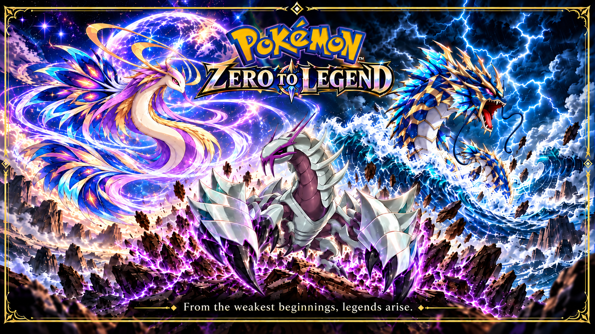

# Pokémon: Zero to Legend · v1.0

*From the weakest beginnings, legends arise.*

What if the Pokémon everyone overlooked became your most extraordinary partner?

Choose **Magikarp, Feebas or Wimpod** and grow together through **Johto and Kanto** in this free, unofficial Game Boy Advance readaptation of **Pokémon Heart & Soul 2.0**. Take on 16 Gyms, confront Team Rocket, challenge the Pokémon League and follow the road to Mt. Silver. Your partner's custom evolution, powers and Tideborn Awakening turn an unlikely beginning into a journey of its own.

**The full main adventure is included.** Beyond the badges, discover optional encounters, build your team and explore the Battle Frontier.

### Download and begin

[**Download the v1.0 UPS patch**](https://github.com/PhabejSam/pokemon-zero-to-legend-release/releases/download/v1.0/Pokemon-Zero-to-Legends.ups) · [**Installation guide**](INSTALL.md) · [Release & complete package](https://github.com/PhabejSam/pokemon-zero-to-legend-release/releases/tag/v1.0)

You need your own clean **Pokémon Emerald (USA, Europe), revision 0**: 16 MiB, CRC32 **1F1C08FB**. Apply the UPS directly to Emerald—no intermediate Heart & Soul patch. No ROM or BIOS is supplied. **Returning players: back up your battery save and use normal Continue, not an old save state.** [Save compatibility](COMPATIBILITY.md)

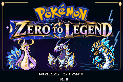

## Meet your unlikely partner

All three begin at level 5 and evolve at **level 30**. These exclusive journeys belong to the original partner you receive from Professor Elm. Catching another Pokémon of the same species does not grant its custom powers.

| Partner | Journey | Battle identity |
| --- | --- | --- |
| **Magikarp** | Gyarados → Awakened Gyarados | A **Water/Dragon** physical powerhouse, built around fierce offense. |
| **Feebas** | Milotic → Awakened Milotic | A **Fairy/Dragon** special attacker with graceful recovery tools. |
| **Wimpod** | Redesigned Golisopod → Awakened Golisopod | A **Bug/Dragon** armored defender with shield-like claws and endurance. |

<table><tr><td width="50%">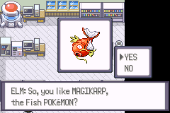 <em>Every legend starts with a choice.</em></td><td width="50%">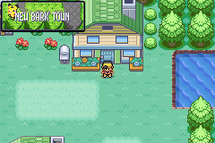 <em>Your first steps out of New Bark Town.</em></td></tr></table>

Your partner gains strength as it levels, retains **Legend's Resolve**, and develops new powers through evolution and awakening. Custom battle sprites and followers bring each form to life. Build a full team around it—the early adventure still rewards preparation.

[Meet every form, compare stats and explore ordinary movesets](MOVES-AND-STATS.md) · [Starter setup and Powers guide](PLAYER-GUIDE.md)

## Johto · An adventure worth growing into

From Violet City's first challenge to Ecruteak's ancient towers, Johto is a region of quiet towns, old legends and unexpected trouble. Help Olivine's sick Ampharos, investigate the Lake of Rage and face Team Rocket's return through Mahogany and Goldenrod. Eight badges lead toward the Elite Four and Champion Lance.

<table><tr><td width="50%">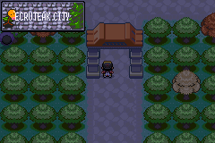 <em>Old stories wait in Ecruteak.</em></td><td width="50%">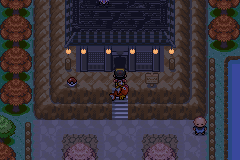 <em>Step into the history of the Burned Tower.</em></td></tr></table>

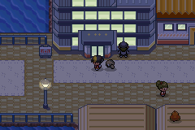 <em>Goldenrod's bright streets hide a much bigger story.</em>

## Kanto · The journey opens up

Becoming Champion is a new beginning. Sail toward Vermilion aboard the **S.S. Aqua**, explore familiar cities with fresh purpose, investigate the Power Plant's missing Machine Part and pursue eight more Gym badges. From Seafoam's icy passages to Blue's Viridian challenge, a second region awaits.

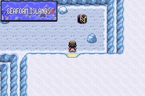 <em>Follow the cold paths of Seafoam Islands.</em>

## Tideborn Awakening · More than an evolution

The **Lake of Rage** marks a turning point for your original partner. **Tideborn Awakening** is the shared story milestone; the form and power you gain are unique to your starter's line.

- **Gyarados:** Rising Tyrant and Tidal Sovereign amplify its Water/Dragon offense.
- **Milotic:** Mystic Grace and Celestial Sovereign strengthen its Fairy/Dragon attacks.
- **Golisopod:** Abyssal Bulwark develops into Leviathan's Aegis, bringing stronger protection and gradual recovery.

<table><tr><td width="33%">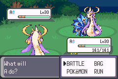 <em>Celestial grace.</em></td><td width="33%">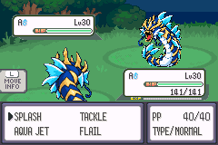 <em>The force of a storm.</em></td><td width="33%">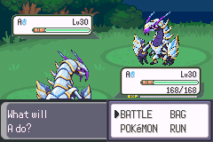 <em>Armored resolve.</em></td></tr></table>

Read the in-game **Summary → Powers** page for your partner's current abilities. Our [player guide](PLAYER-GUIDE.md#powers) explains the effects; the [evolution guide](MOVES-AND-STATS.md) covers ordinary learnsets.

## Beyond the badges

Pursue the path through **Mt. Silver to Red**, return for stronger challenges, seek optional legendary encounters, or spend time breeding, entering Contests and refining your team. The inherited **Battle Frontier** offers Tower, Factory, Dome, Arena, Palace, Pike and Pyramid activities, each with its own approach to battling.

<table><tr><td width="50%">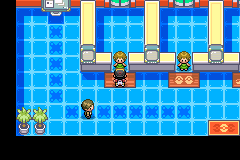 <em>Bring your next team to the Battle Tower.</em></td><td width="50%">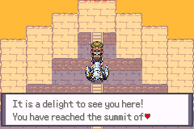 <em>Climb toward the Battle Pyramid summit.</em></td></tr></table>

Some optional facility, reward and event paths have limited verification. [Known limitations](KNOWN-LIMITATIONS.md) explains those boundaries and save precautions.

## Final Ascension · A secret at level 100

For an awakened partner raised to **earned level 100**, one final discovery awaits.

An exclusive technique. A cinematic moment. A reward best experienced with the Pokémon that started it all.

**The names, effects and animations stay in the game.**

## Build the team you want

- **EV Training Kit:** collect six of every Power item from your player's PC Item Storage. Each supplies **+8 EVs in its matching stat** during eligible battles; the opponent's ordinary EV yield still applies.
- **Free PC IV Training:** improve selected actual IVs, or all six, to 31 at a Pokémon Center PC. Review the Hidden Power warning before confirming.
- **Starter Setup:** personalize your original partner's shininess, nature, IVs and EVs. Progression must still be earned.
- **Free starter move management:** relearn eligible moves, delete moves or reorder them through your original partner's Summary. Read permanent-choice warnings carefully.
- **PP Max for 5 BP:** visit the Battle Frontier Exchange Service Corner's **vitamin clerk**.
- **Travel and battle conveniences:** following Pokémon, indoor running, autorun, faster surfing/fishing options, configurable EXP settings, visible IVs/EVs and reusable TMs under recommended defaults.

Settings, story unlocks and challenge restrictions still apply. [Training instructions](TRAINING.md) · [Controls and custom features](PLAYER-GUIDE.md)

## Walkthroughs & Player Resources

Need help finding your way through Johto or Kanto? Thank you to the **Heart & Soul team** for their extensive player documentation:

- [Official documentation](https://pokemonhns-development.github.io/pokehns-expansion-documentation/index.html)
- [Adventure walkthrough](https://pokemonhns-development.github.io/pokehns-expansion-documentation/walkthrough.html)
- [Wild encounters](https://pokemonhns-development.github.io/pokehns-expansion-documentation/encounters.html)
- [Gifts and static encounters](https://pokemonhns-development.github.io/pokehns-expansion-documentation/statics.html)
- [Items and TMs](https://pokemonhns-development.github.io/pokehns-expansion-documentation/items.html)
- [Trainer information](https://pokemonhns-development.github.io/pokehns-expansion-documentation/trainers.html)

**Use these as references for the inherited adventure.** The site identifies its current data as **Heart & Soul 2.0.6**, while its walkthrough explicitly warns that it was written for an older version and is not fully updated. Zero to Legend uses an earlier 2.0 foundation with substantial custom changes. Encounter rates, teams, items and event details may differ. For our starters, evolution, Awakening, regular signature moves and PC training, use the [Zero to Legend player guide](PLAYER-GUIDE.md), [moves and stats](MOVES-AND-STATS.md), and [training guide](TRAINING.md).

## Play comfortably · Save safely

The owner completed Johto, Kanto and Red on **Anbernic RG40XX H / VBA Next**, and passed the exact v1.0 candidate's handheld acceptance checklist. Desktop mGBA/VBA Next checks provide additional, scoped evidence. Other devices and core versions are not universally certified.

Back up your own battery save before updating. Same-edition existing progress passed owner acceptance; arbitrary old versions, other hacks' saves, old emulator save states and cross-edition transfers are not certified. **The separate DSi compatibility candidate is experimental and is not included here.**

[Installation](INSTALL.md) · [Compatibility](COMPATIBILITY.md) · [Known limitations](KNOWN-LIMITATIONS.md) · [Release notes](RELEASE-NOTES.md) · [Report a bug](BUG-REPORT.md)

About the screenshots

These are authentic native emulator captures from Zero to Legend, reproduced without retouching. The title is from the frozen v1.0 candidate. Opening and Johto scenes come from earlier recorded gameplay builds; battle demonstrations, Seafoam and Frontier scenes use prepared emulator sessions. The three battle teams illustrate approved forms, not natural progression or recommended learnsets. They are not owner handheld photos or new QA passes. [Capture context and provenance](SCREENSHOTS.md)

## Made possible by a community

This adventure is a readaptation of **[Pokémon Heart & Soul 2.0](https://github.com/PokemonHnS-Development/pokehns-expansion)**. Thank you to **LIL DILL**, the HnS developers, artists, map contributors and playtesters, along with **Modern Emerald**, **RHH / Rom Hacking Hideout**, **pret**, and the many individual resource contributors. **PhabejSam** directs Zero to Legend's creative vision and playtesting.

**Golisorus inspiration:** special thanks to **[u/JJonnie](https://www.reddit.com/r/pokemon/comments/17b3du2/i_made_a_dragon_type_golisopod/) / [@jjonnydraws](https://www.youtube.com/@jjonnydraws)** for permission to use his armored-dragon concept as inspiration for our redesigned Golisopod, adapted sprites, awakened forms, animations and promotional artwork. Written permission was received October 22, 2026, as confirmed by the owner; no endorsement is implied.

[Full credits](CREDITS.md) · [Notices and distribution disclosure](NOTICES.md)

An unofficial, noncommercial fan project, unaffiliated with Nintendo, Game Freak, Creatures Inc. or The Pokémon Company. Artwork includes AI-assisted source artwork and subsequent native pixel refinements. Attribution and publication do not imply comprehensive third-party rights clearance; see the notices above.
